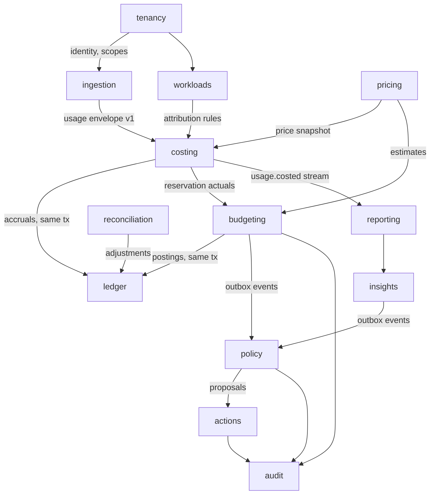
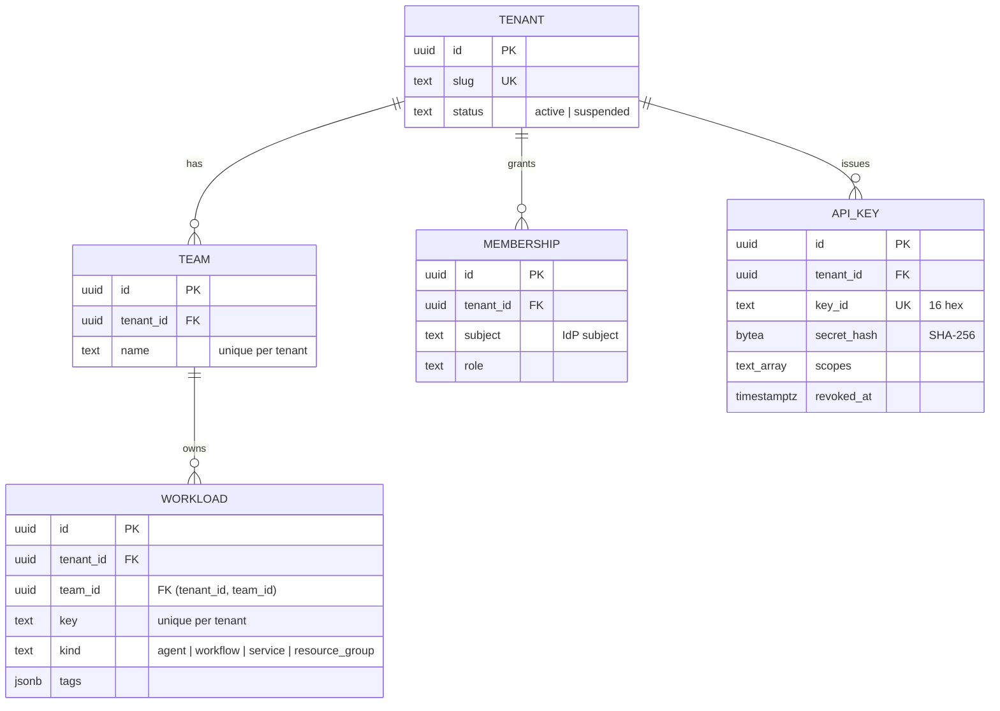

# Domain model

CloudPulse has 13 bounded contexts plus a shared kernel. Each context is one module in
`apps/platform/src/modules`. Modules are created in the phase that implements them; Milestone 1
contains `tenancy`, `workloads` and `ingestion`.

## Context map

| Context        | Owns                                                        | Phase | Runs in                     |
| -------------- | ----------------------------------------------------------- | ----- | --------------------------- |
| tenancy        | tenants, teams, memberships, roles, API keys                | 1     | api, gateway (key lookup)   |
| workloads      | workloads, resource bindings, attribution rules             | 1     | api                         |
| ingestion      | envelope validation, event time window, producer, consumers | 1–2   | gateway, workers            |
| pricing        | price books, versions, rules, FX rates                      | 3     | api, cost worker            |
| costing        | cost lines, unpriced usage, repricing                       | 3     | cost worker                 |
| ledger         | double-entry transactions and postings                      | 3     | caller's transaction        |
| budgeting      | budgets, periods, reservations                              | 4     | api, cost worker, scheduler |
| policy         | policy versions, evaluations, cooldowns                     | 5     | governance worker, api      |
| actions        | action state machine, approvals, provider adapters          | 5     | api, governance worker      |
| audit          | hash-chained audit records                                  | 5     | caller's transaction        |
| insights       | anomalies, forecasts, recommendations                       | 6     | scheduler                   |
| reconciliation | billing imports, matching, discrepancies                    | 7     | api, scheduler              |
| reporting      | ClickHouse read models                                      | 3     | api                         |

## Implemented model (Milestone 1)

### tenancy

- **Tenant**: slug `^[a-z0-9][a-z0-9-]{1,62}$`, status `active` or `suspended`. Keys of a suspended
  tenant stop authenticating.
- **Team**: name 1–120 characters, unique per tenant.
- **Membership**: `(tenant, subject, role)` is unique. Roles map to permissions in
  `domain/rbac.ts`.
- **ApiKey**: issued by `ApiKey.issue()`, which returns the plaintext once. 256-bit secret, SHA-256
  digest compared in constant time. `revoke()` is idempotent and keeps the first timestamp.
- Use cases: `TeamService` (create, list), `ApiKeyService` (issue, list, revoke),
  `ApiKeyAuthenticator` (gateway), `ActorResolver` (JWT identity to actor).

### workloads

- **Workload**: key `^[A-Za-z0-9][A-Za-z0-9_.:-]{0,127}$`, unique per tenant; kind from a closed set;
  tags are a string-to-string map with bounded size. A workload belongs to one team of the same
  tenant, guaranteed by the composite foreign key `(tenant_id, team_id) → team (tenant_id, id)`.
- Use cases: `WorkloadService.register` (conflict → `409 workload_key_conflict`, foreign team →
  `422 team_not_found`) and keyset-paginated listing over UUIDv7 ids.

### ingestion

- **Envelope v1** lives in `packages/contracts` and is shared with producers. Structural validation
  (Ajv) plus semantic checks: allowed dimensions per event type, unit per dimension, duplicates, and
  `outcome` required on `execution.completed`.
- **Event time window**: 35 days of lateness, 5 minutes of future skew (`domain/event-time-window.ts`).
- The producer, consumer runtime, retry and DLQ topics arrive in Phase 2.

## Shared kernel

- `Money`: decimal.js with 50 digits of precision, scale 12, HALF_EVEN; constructed only from strings;
  currency-safe arithmetic; display rounding per currency minor unit.
- `ids`: UUIDv7 generation and validation.
- `Clock`: injectable time source (`SystemClock`, `FixedClock` for tests).
- `errors`: `CodedError` with a category (`validation`, `unauthenticated`, `forbidden`, `not_found`,
  `conflict`, `unprocessable`, `unavailable`) and a stable machine-readable code, mapped to HTTP
  status by the problem-details filter.

## Consistency

Strongly consistent, in one PostgreSQL transaction: everything in tenancy and workloads today, and
later reservations with counters and ledger postings, cost line insertion with accruals, action
transitions with approvals and audit records, and outbox rows with the state change that produced
them.

Eventually consistent: ClickHouse analytics, budget consumption from passive usage (lag of the cost
worker), insights, reconciliation and dashboards.
