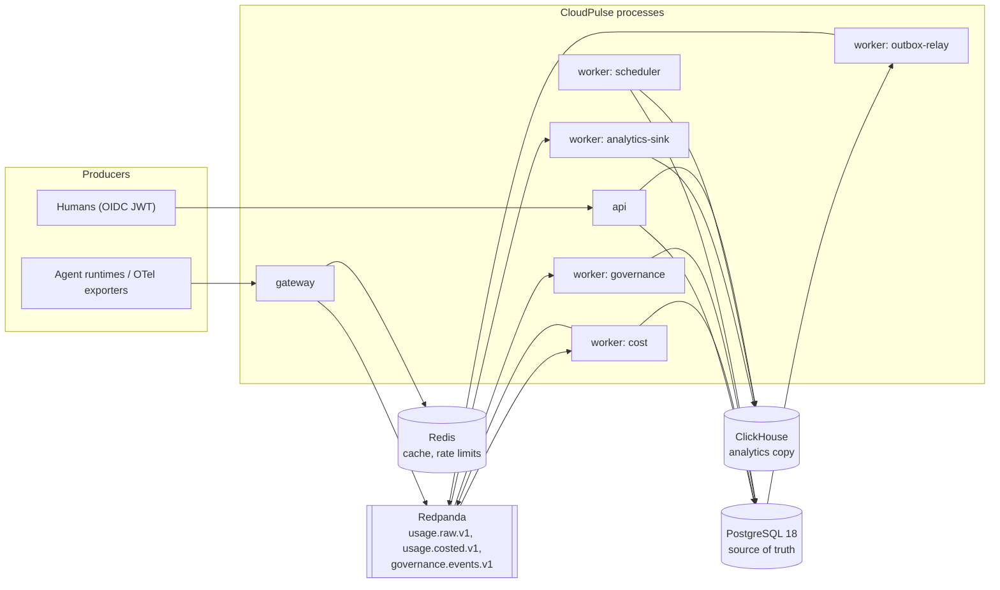

# Architecture overview

## Shape

CloudPulse is a modular monolith: one NestJS codebase in `apps/platform`, compiled once, started as
several processes. Each process role has its own entrypoint, its own composition root and its own
readiness definition (ADR-001).



| Process                 | Entry point           | Ready when                  | State in Milestone 1                    |
| ----------------------- | --------------------- | --------------------------- | --------------------------------------- |
| api                     | `src/main.api.ts`     | PostgreSQL                  | Teams, workloads, API keys              |
| gateway                 | `src/main.gateway.ts` | Redpanda, Redis, PostgreSQL | Health, API key authenticator, contract |
| worker `cost`           | `src/main.worker.ts`  | PostgreSQL, Redpanda        | Health only                             |
| worker `analytics-sink` | `src/main.worker.ts`  | Redpanda, ClickHouse        | Health only                             |
| worker `governance`     | `src/main.worker.ts`  | PostgreSQL, Redpanda        | Health only                             |
| worker `outbox-relay`   | `src/main.worker.ts`  | PostgreSQL, Redpanda        | Health only                             |
| worker `scheduler`      | `src/main.worker.ts`  | PostgreSQL, ClickHouse      | Health only                             |

Liveness (`/health/live`) never checks dependencies, so an outage of PostgreSQL makes processes
not-ready instead of restarting them. Readiness (`/health/ready`) returns `503` with a per-dependency
status, latency and error when any required dependency fails or exceeds `READINESS_TIMEOUT_MS`.
Processes start without their dependencies; MikroORM connects lazily.

## Code organization

```
src/
  main.{api,gateway,worker}.ts   entrypoints (top-level await bootstrap)
  telemetry.ts                   OpenTelemetry preload (--import), opt-in by env
  app/                           composition root: role modules, ORM config, bootstrap
  modules/<context>/
    domain/                      pure TypeScript: entities, value objects, rules
    application/                 use cases, authorization, transactions
    infrastructure/              MikroORM schemas, repositories, SQL
    api/                         controllers, guards, DTO schemas
    index.ts                     the only file other modules may import
  platform/                      cross-cutting technical services (no business modules)
  shared-kernel/                 Money, ids, clock, coded errors
  migrations/                    SQL migrations, owned by the migrator role
```

`dependency-cruiser` enforces the rules in CI (`pnpm boundaries`): no imports of another module's
internals, a framework-free domain layer, domain not importing outer layers, application not
importing api, platform and shared kernel not importing modules, no cycles, and no unresolved
imports. A fixture under `test/boundaries/fixture` proves each rule fails when violated.

Domain classes are plain TypeScript. MikroORM maps them with `EntitySchema` definitions in
`infrastructure/`, so domain files never import the ORM.

## Request path (api)

1. Fastify assigns a UUIDv7 request id and returns it as `x-request-id`.
2. `ActorGuard` verifies the bearer JWT (`jose`, JWKS, allowed algorithms EdDSA, ES256, RS256,
   required `sub`, `exp`, `tid`) and resolves roles from `membership`. Routes marked `@Public()`
   skip it.
3. The `TypeBoxPipe` validates input with Ajv and produces field errors with stable codes.
4. The application service calls `authorize(actor, permission)`, then runs its work through
   `TenantTransactions.run(tenantId, work)`.
5. `TenantTransactions` opens one transaction, sets `app.tenant_id` with transaction-local
   `set_config`, and enables the ORM `tenant` filter. RLS policies read the setting.
6. Errors become RFC 9457 `application/problem+json` documents with `type`, `title`, `status`,
   `detail`, a stable `code`, `instance`, `requestId` and, when tracing is on, `traceId`. Unknown
   errors become an opaque `500` and are logged with the request id.

## Tenant isolation (ADR-008)

| Database role         | Owns tables | RLS applies | Used by                      |
| --------------------- | ----------- | ----------- | ---------------------------- |
| `cloudpulse_migrator` | yes         | no (owner)  | migrations, dev seeding      |
| `cloudpulse_api`      | no          | yes         | api, gateway                 |
| `cloudpulse_worker`   | no          | bypassed    | workers (repositories scope) |

Every tenant-owned table has a `tenant_isolation` policy comparing `tenant_id` with
`cp_current_tenant()`, which reads `app.tenant_id`. With no setting the function returns `NULL` and
no row matches. The api role has no `DELETE` grant and can update only `revoked_at` on `api_key`.

The gateway must find an API key before it knows the tenant. It calls the `SECURITY DEFINER`
function `cp_lookup_api_key(key_id)`, which returns one key's verification fields and nothing else,
so the gateway's role stays under RLS for all other reads.

Integration tests prove these properties against a real PostgreSQL 18 (`test/integration/rls.test.ts`).

## Data flows (target design)

- **Ingestion (Phase 2).** Gateway authenticates the key, validates envelope v1, checks the event
  time window, derives the tenant, and produces to `usage.raw.v1` keyed by `tenant:execution`. It
  returns `202` only after the broker acknowledges.
- **Costing (Phase 3).** The cost worker prices events against an in-memory price snapshot, inserts
  cost lines with `ON CONFLICT DO NOTHING`, accrues budgets and the ledger only for newly inserted
  lines in the same transaction, and emits `usage.costed.v1`.
- **Analytics (Phase 3).** The analytics sink writes ClickHouse; the scheduler recomputes rollups
  over the lateness window (ADR-010).
- **Governance (Phases 4 and 5).** State changes write outbox rows in the same transaction; the
  relay publishes them; the governance worker evaluates policies and drives the action state machine.

## Configuration and operations

- Configuration is validated at boot from environment variables (TypeBox schema). Every problem is
  reported at once and the process exits with status 1. Each role reads `DATABASE_URL_<ROLE>` first,
  then `DATABASE_URL`. A dev-only JWKS file is refused in production.
- Logs are JSON (pino) with redaction of authorization headers, cookies, tokens, secrets and API keys,
  and carry the active trace id.
- OpenTelemetry auto-instrumentation and OTLP export start only when
  `OTEL_EXPORTER_OTLP_ENDPOINT` is set.
- One container image serves every role (`apps/platform/Dockerfile`); the command selects the
  entrypoint.
